# PMO 项目群管理台

面向**项目群（Program）**的 PMO 协作与治理平台。项目团队在这里维护自己的计划、周报、里程碑和风险；PMO 在这里评审阶段关口、审核确认，并自动汇总成项目群层面的周报与工作计划。

视图上参考了 Asana 的几个核心能力：带依赖的时间轴（Timeline）、我的待办（My Tasks）、组合视图（Portfolio）和工作量（Workload）。

不是又一套任务看板——它解决的是项目群管理里最费时的那部分：**收材料、对口径、催提交、拼汇报**。

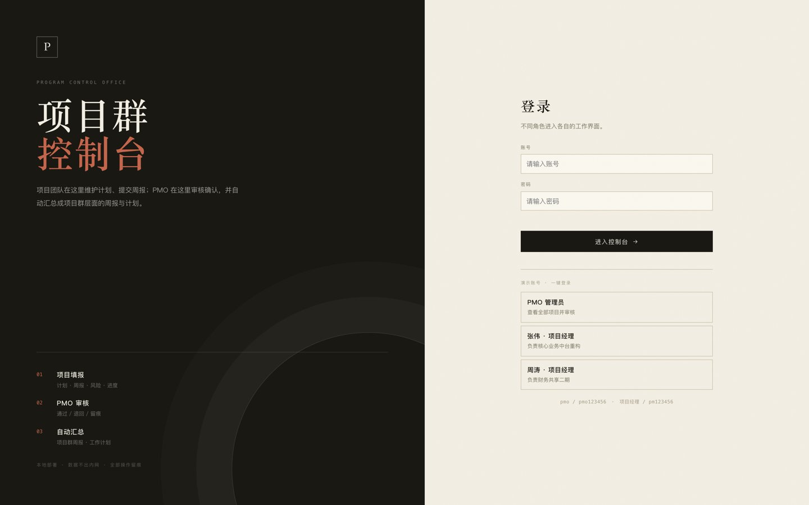

## 角色与流程

| 角色 | 能做什么 |
| --- | --- |
| **项目经理（PM）** | 维护自己负责项目的进度、里程碑、风险、人员投入；填写并提交项目周报与项目计划；查看被退回的原因并修改重提 |
| **PMO 管理员** | 查看全部项目；审核通过或退回周报与计划；维护项目台账与组合数据；管理账号与项目授权；导出项目群周报与工作计划 |

一条完整链路：

```
项目组填写草稿 → 提交审核 → PMO 审核 ──通过──→ 进入项目群周报 / 项目群计划
                              └──退回（必须写原因）→ 项目组修改 → 重新提交
```

所有提交、审核、退回、台账变更都会写入审计日志，记录操作人、时间和对象。

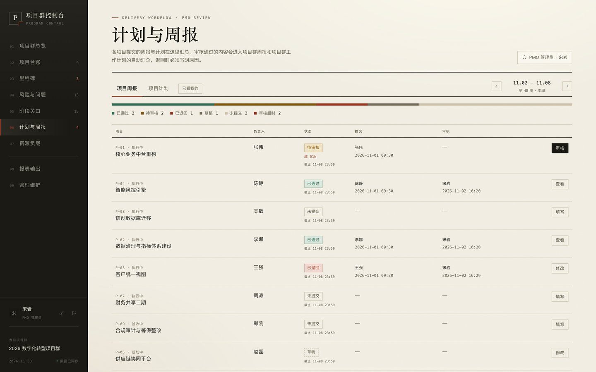

周报写作页只有一个 Markdown 正文，进度、计划任务和项目现状放在右侧参考；提交检查、审核意见和历史版本同屏：

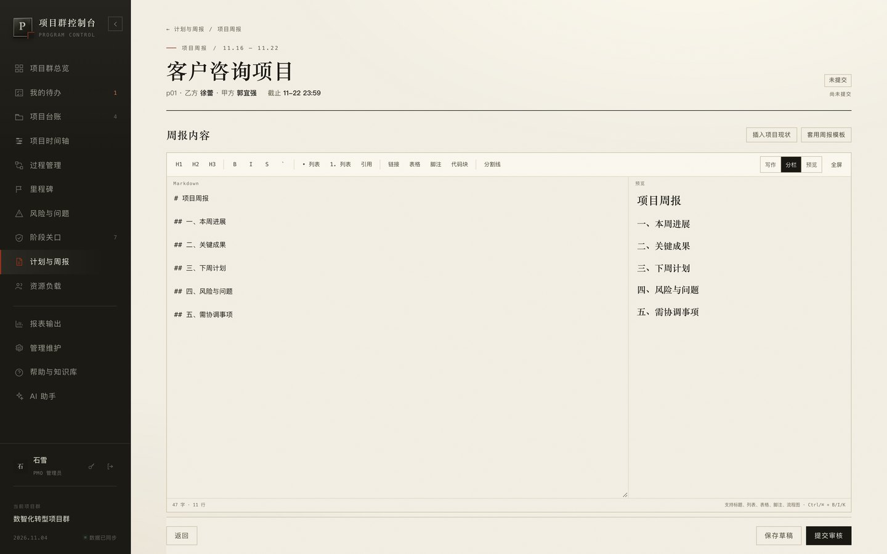

## 快速开始

要求 Node.js **22.5 及以上**（使用内置 `node:sqlite`，不需要 `npm install`）。

```bash
# 方式一
node server.js

# 方式二：自动打开浏览器
./start.sh
```

打开 <http://127.0.0.1:5177>。首次启动自动建库并写入 9 个示例项目、27 个阶段关口、6 份周报、4 份计划、8 份章程、7 条变更、5 条经验教训和 19 个账号（1 个 PMO + 9 个乙方项目经理 + 9 个甲方项目经理）、5 家乙方供应商、5 个项目模板、16 天工作日历设置、6 周演示快照和 21 篇帮助文章。

部署到内网、离线安装 Node、systemd / Nginx / Docker、备份恢复和二次开发约定，见 [DEPLOY.md](DEPLOY.md)。日常备份可以直接跑：

```bash
npm run backup
node scripts/verify-backup.js backups/pmo-<时间>.db
```

macOS 每日 02:00 自动备份：`./scripts/install-daily-backup.sh`。备份会同时保存数据库、AI 密钥和校验清单；只在本机 `backups/` 时仍建议再拷一份到别的机器。

跑测试（使用临时数据库，不影响演示数据）：

```bash
npm test
```

### 侧栏收起

左侧导航右上角有收起按钮。收起后宽度从 236px 变成 78px，主内容自动让位；每个栏目有图标，收起时只显示图标，鼠标悬停弹出栏目名提示，底部头像、改密和退出仍然可用。

收起状态记在浏览器本地，刷新或重新登录后保持。手机窄屏下侧栏变成顶部横向导航，收起按钮自动隐藏。

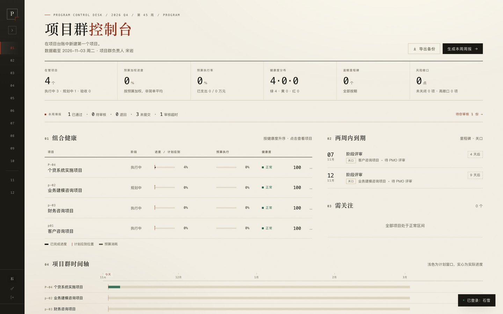

### 演示账号

| 账号 | 密码 | 角色 |
| --- | --- | --- |
| `pmo` | `pmo123456` | PMO 管理员（宋岩） |
| `zhangwei` | `pm123456` | 乙方项目经理 · 张伟（P-01 核心业务中台重构） |
| `hejing` | `pm123456` | 甲方项目经理 · 何静（P-01 核心业务中台重构） |
| `wangqiang` | `pm123456` | 乙方项目经理 · 王强（P-03 客户统一视图，有一份被退回的周报） |
| `zhoutao` | `pm123456` | 乙方项目经理 · 周涛（P-07 财务共享二期） |

登录页提供 PMO、乙方、甲方三个一键登录按钮。其余乙方账号为 `lina` / `chenjing` / `zhaolei` / `sunqian` / `wumin` / `zhengkai`，甲方账号为 `maxiao` / `gaoxiang` / `xulei` / `zhoumin` / `lintao` / `jiangnan` / `luocheng` / `tangyue`，密码同为 `pm123456`。

甲方项目经理和项目的对应关系：P-02 马骁、P-03 高翔、P-04 徐蕾、P-05 周敏、P-06 林涛、P-07 蒋楠、P-08 罗成、P-09 唐悦。

```bash
PMO_PORT=8080 node server.js       # 换端口
PMO_HOST=0.0.0.0 node server.js    # 允许局域网访问（无 HTTPS，谨慎）
```

## 功能

### 帮助中心与智能知识库

侧栏新增「帮助与知识库」，页面分两个页签：

- **知识库**：21 篇内置文章，支持关键词检索和分类筛选；正文用 Markdown，可以直接看表格、脚注和流程图。
- **智能问答**：独立整页对话，有示例问题、对话记录、参考来源和清空按钮；配置模型后由模型基于知识库回答，没配置时返回最相关的知识库文章，不会假装知道。
- **搜索**：输入关键词即可实时过滤，按 Enter 或点「搜索」立即查；显示命中篇数，支持清空。
- 问答支持 `Ctrl / ⌘ + Enter` 发送，生成结果会标出「知识库检索」还是哪个模型。
- PMO 在管理维护 →「知识库」增删改文章，可设为草稿或发布。

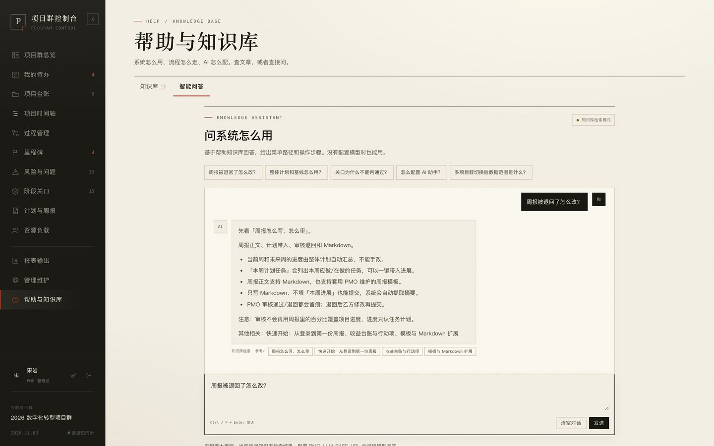

### 项目知识库

项目页新增「项目知识库」页签：

- 自动索引项目概况、章程、整体计划任务、季度计划、周报、里程碑、风险、关口及检查项、变更、经验教训、收益、行动项、验收。
- 打开页面时按当前数据实时生成，不维护第二份副本，不会出现“知识库没同步”的问题。
- 支持关键词检索和类型筛选，每条都能展开看正文、跳回来源页面。
- PMO 和乙方项目经理可以补「项目笔记」；甲方只读。草稿/被退回的周报和计划不会通过知识库绕过权限。
- 项目 AI 助手会先检索知识库，把命中的条目带进上下文；回答上方会列出「知识库引用」。

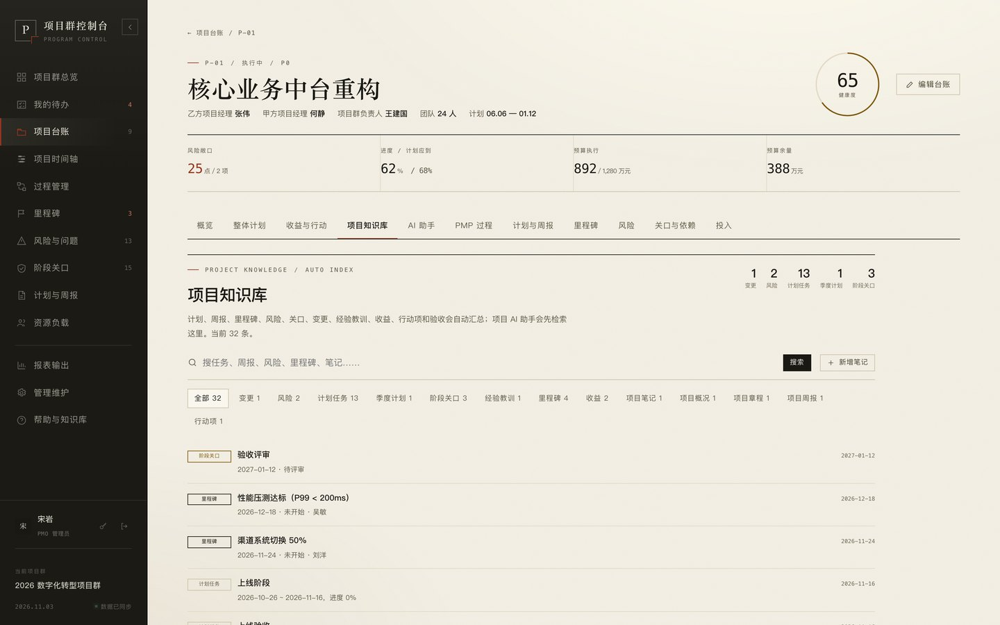

知识库搜索支持输入后实时过滤、按 Enter 立即查、清空搜索，并显示命中条数。

### 完整项目管理流程

帮助中心新增一篇「一个项目从建群到归档：完整操作流程」，按实际操作顺序讲清楚：

- 建项目群、建项目、指定甲乙方项目经理；
- 排 WBS、设计划基线、设关口/里程碑/风险；
- 每周填周报、PMO 审核、退回修改；
- 阶段关口评审、变更审批与重设基线；
- 会议室预订、办公用品领用，按配置的审批角色处理，不能自批；
- 甲方验收、收益/行动项、经验教训和归档。

文章顶部带一张可交互的完整流程图，可以按「准备 / 执行 / 收口 / 协作」四段查看，支持明暗主题、缩放、搜索和导出。

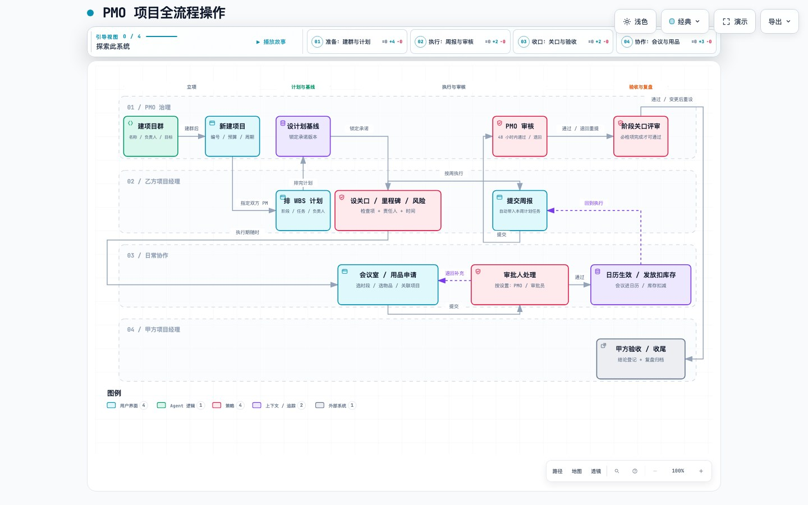

### 全局 AI 助手

侧栏新增「AI 助手」全局页签：

- 默认对当前项目群里当前用户有权限查看的全部项目回答，也可以下拉收窄到单个项目。
- 支持项目群摘要、跨项目风险与延期、自由提问。
- 回答会带项目上下文和知识库引用，引用标签会写清是哪个项目、哪条内容。
- 甲方项目经理只会看到自己有权查看的项目，切换全局范围不会越权。

项目页里的「AI 助手」保留为带项目上下文的快捷入口；页面顶部会按项目现状列出「当前要处理」，包括周报、计划基线、关键任务、关口检查项、风险、里程碑、变更和验收，点条目直接跳到对应页签。

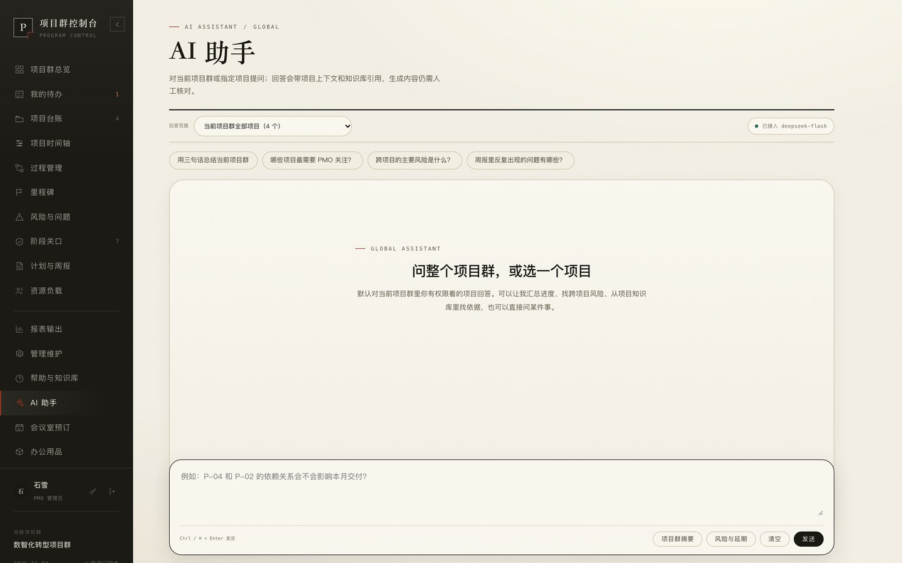

项目 AI 的「当前要处理」会按项目现状列出待办，点条目直接跳到对应页签：

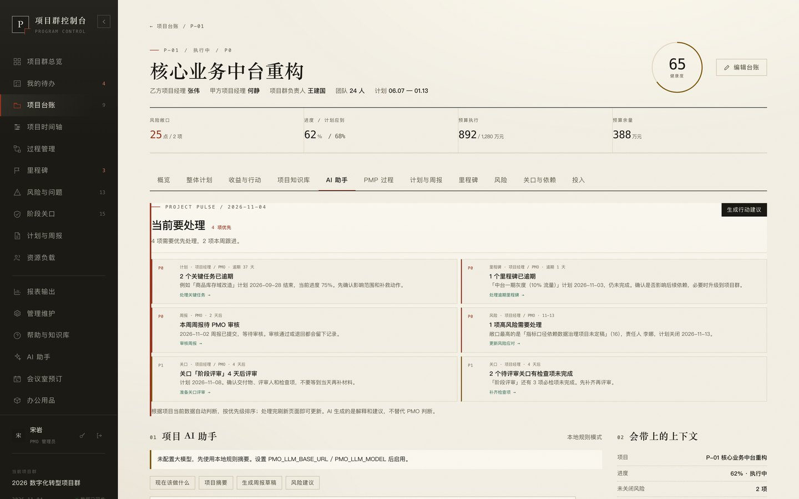

### 项目 AI 助手

项目页新增「AI 助手」页签：

- 一键生成项目摘要、周报草稿、风险建议，也可以针对当前项目自由提问。
- 上下文来自当前项目的进度、风险、里程碑、关口、最新周报和计划摘要；生成的是草稿，不会自动写入周报。
- 没配置模型时使用本地规则摘要，功能不会不可用。

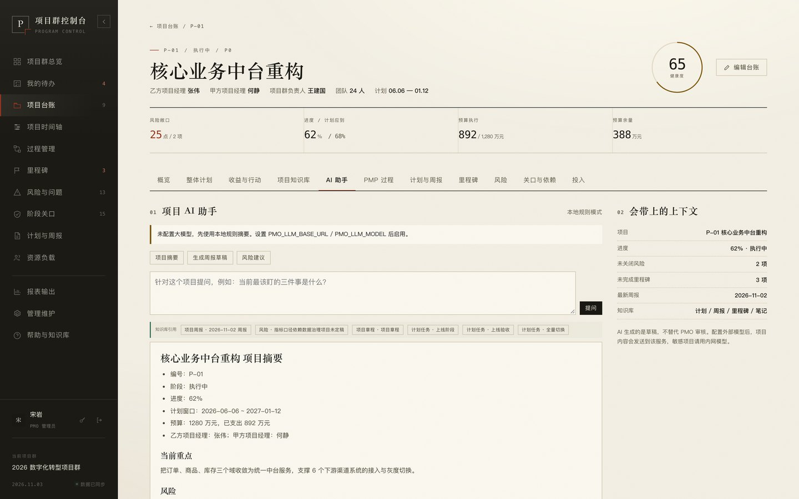

### 管理员配置 AI

管理维护 →「AI 配置」可以直接填服务地址、模型名和 API Key，保存后立即生效，不用改环境变量或重启。

- 支持 OpenAI 兼容接口，也支持本地 Ollama（Key 可以留空）。
- 有「测试连接」按钮，会真的发一次很短的消息。
- API Key 用服务器本机密钥加密后写入数据库，前端只显示“已保存”，不会回显原文。
- 如果服务端设置了 `PMO_LLM_BASE_URL`，以环境变量为准，前端变成只读。
- 换服务器或删除 `data/.ai-key` 后，已保存的 Key 无法解密，界面会提示重新填写。
- 配置外部模型后，项目摘要、风险、周报和知识库片段会发送到该服务；敏感项目请用内网模型。

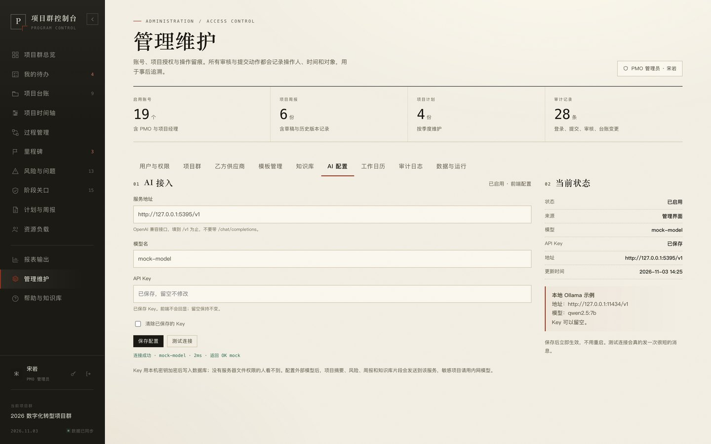

### 会议室预订

侧栏新增「会议室预订」，原生实现，不依赖外部 React/Tailwind：

- 按周看会议室占用，07:00–22:00 时间轴；点空白时段直接预订。
- 每行一个会议室，显示位置、容量和设施；同一会议室同一时段不能重复预订。
- 可关联项目，会议记录能对应到项目编号。
- 所有预订提交后进入「待审批」，由配置的审批角色处理；任何人都不能审批自己的预订。
- 「我的预订」可查看和取消自己的预订；PMO 可维护会议室，停用后不再出现在日历。
- 只显示已批准预订和本人待审批预订，别人的待审批不可见。

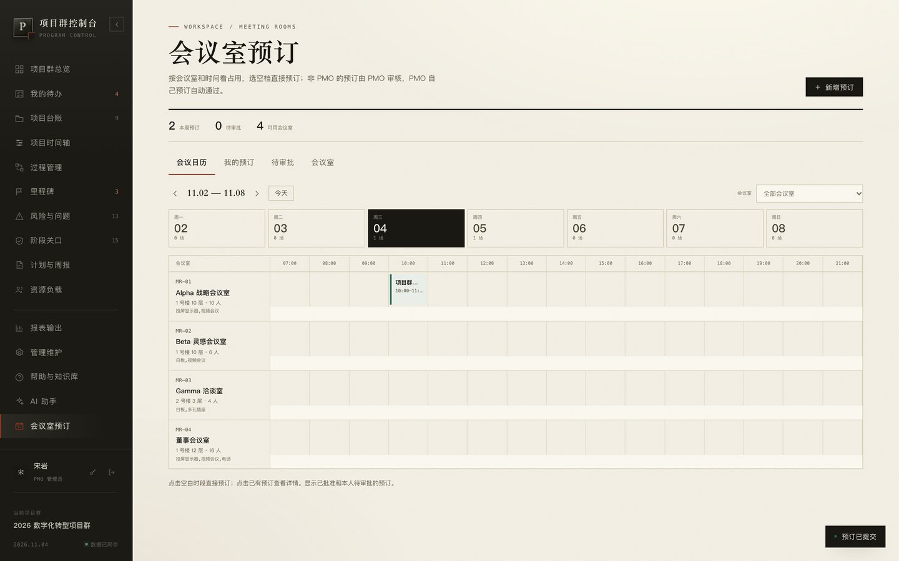

### 办公用品领用

侧栏新增「办公用品」，和会议室一样原生实现：

- 用品目录按分类展示，库存、安全库存和状态一眼能看到。
- 员工提交领用，配置的审批角色发放时扣库存；拒绝和取消不动库存，审批人不能审批自己的申请。
- 可关联项目，领用记录能对应到项目编号。
- 我的领用可取消待发放申请。
- PMO 在「用品管理」维护分类、物品、库存、安全库存和停用状态；有领用记录的物品只能停用不能删除。

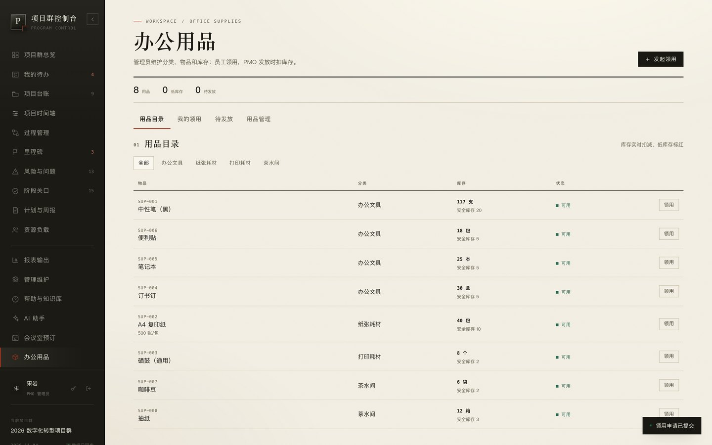

### 多项目群

左侧新增项目群选择器，有多个项目群时才显示：

- 管理维护 →「项目群」可以新增、编辑；有项目的项目群不能删除，先把项目迁走。
- 新建/编辑项目时可以选择所属项目群。
- 切换项目群后，总览、项目台账、关口、依赖、资源、报表、计划与周报列表都会按当前项目群过滤。
- 项目详情页仍按项目权限控制，和当前选中的项目群无关。
- 指标周快照目前还是单项目群历史；切到新项目群时趋势为空，后续需要按项目群拆分快照。

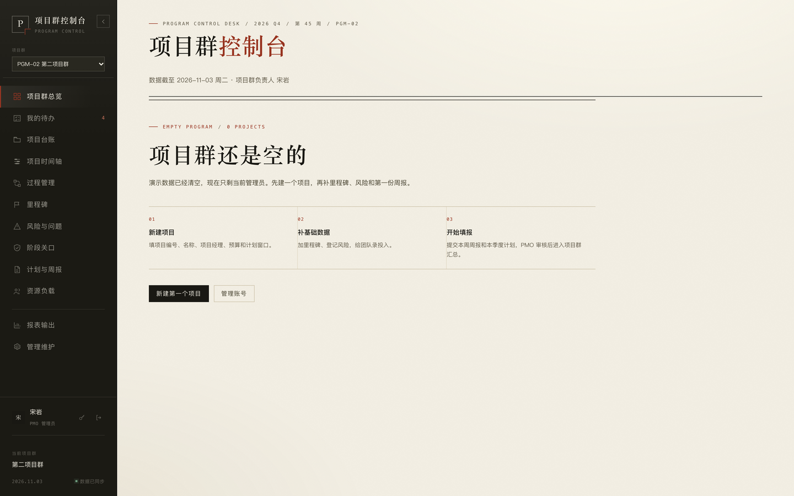

### 项目群总览

6 项组合指标、组合健康表（进度条上的红竖线是「按计划今天应该到哪」）、本周填报状态条、两周内到期、需关注项目、项目群时间轴、高敞口风险、近期动态。

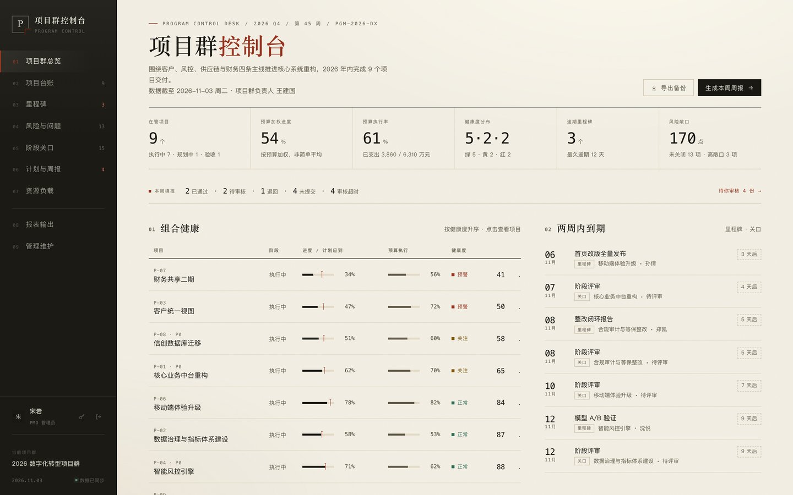

### Markdown 扩展

周报正文和模板正文支持比基础 Markdown 多一些的东西：

- **复杂表格**：列对齐（`:---`、`---:`、`:---:`）、单元格内 `\|` 转义竖线、单元格内 `<br>` 换行、表格内加粗/代码/链接。
- **脚注**：`[^1]` 引用，`[^1]: 说明` 定义；文末自动生成脚注区，点击编号回到正文，不会跳走页面。
- **流程图**：用 Mermaid 的 `flowchart TD` / `flowchart LR` 写节点和有向边，渲染成内联 SVG；支持矩形、圆角、菱形判断、带标签的边和回边。

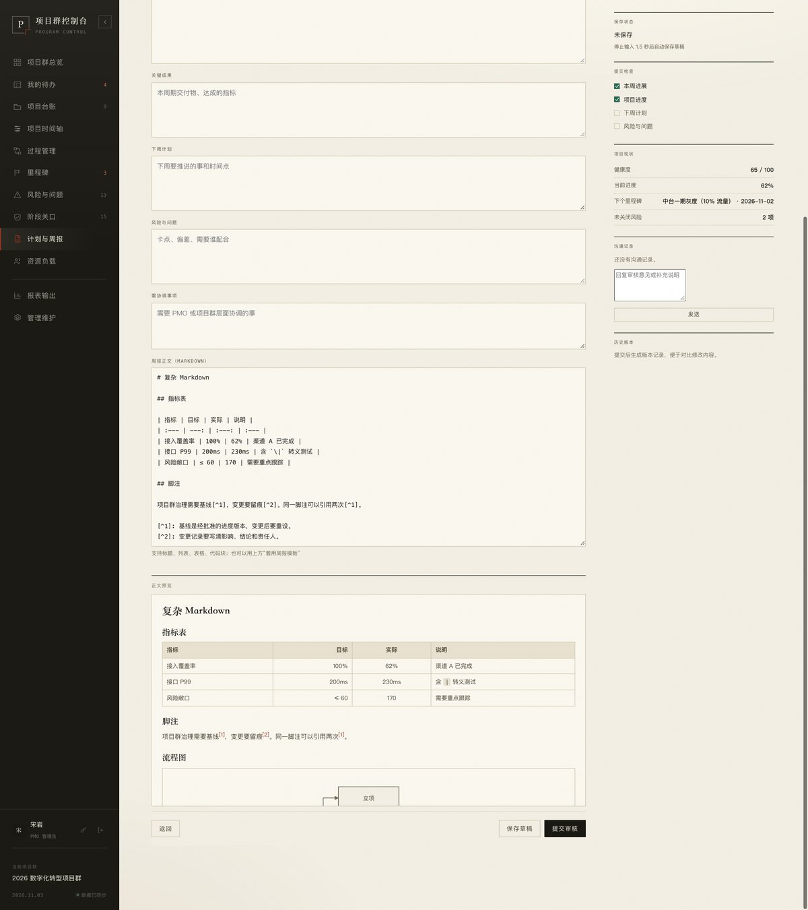

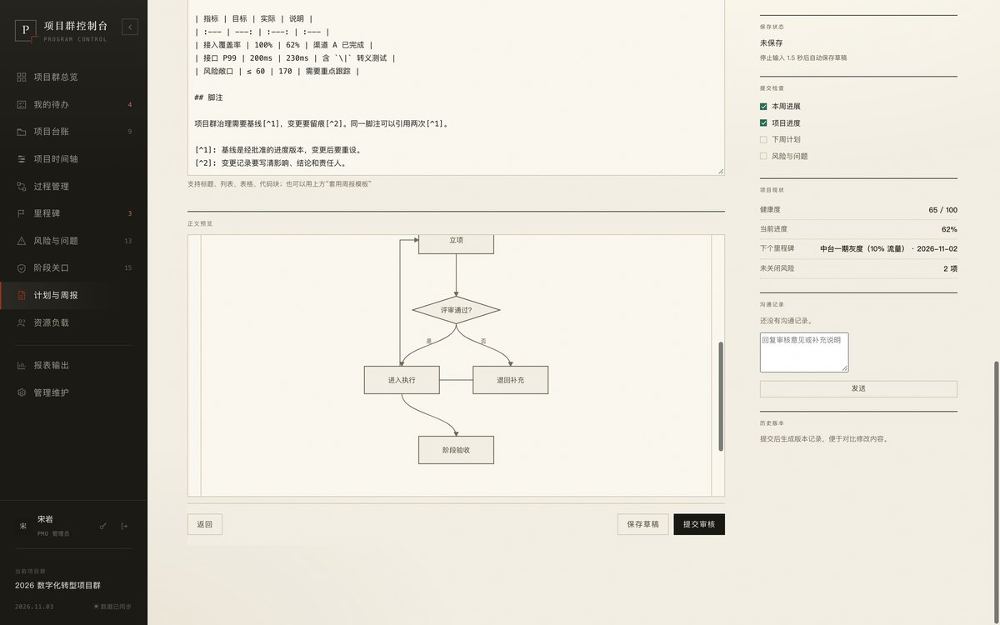

暂不支持表格合并单元格、Mermaid 子图/时序图/甘特图；流程图只做常用节点和有向边，不追求完整 Mermaid 语法。

### 模板管理与 Markdown 周报

管理维护新增「模板管理」，模板不只是一张周报表：

- 分类：项目周报、项目计划、里程碑、风险、阶段关口、其他。
- 每个分类可以设一个默认模板；周报填报时自动带出默认模板。
- 正文用 Markdown 维护，支持标题、列表、表格、代码块、引用。
- 项目计划页和里程碑页有「模板参考」，可以查看 PMO 维护的对应模板，不会改动当前项目内容。

周报不再拆成多个结构化输入框，只有一个 Markdown 正文。编辑器占满主区域，右侧参考/沟通/版本移到下方，工具栏可以切换「写作 / 分栏 / 预览」：

- 工具栏：标题、加粗、斜体、删除线、行内代码、列表、引用、链接、表格、脚注、代码块、分割线。
- 快捷键：`Ctrl / ⌘ + B/I/K`，Tab 插入缩进，Esc 退出全屏。
- 停止输入 1.5 秒自动保存草稿；「插入项目现状」可以生成初稿或在末尾追加参考。
- 进度从项目整体计划同源带出，周报里不再手填百分比。
- PMO 审核和项目群报表需要的摘要、风险、需协调事项，由服务端从 Markdown 对应小节自动提取；只有标题和空列表不算正文，提交会被拦下。

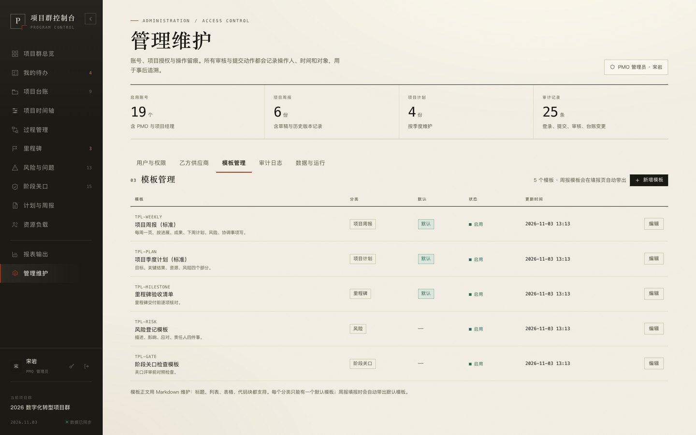

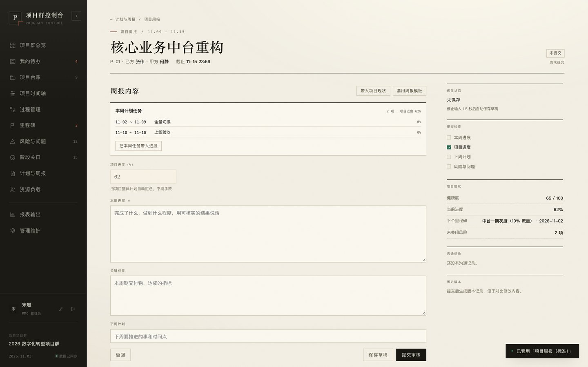

### 组合优先级

总览新增「组合优先级」，按五项评分把项目排个先后：

- 战略契合 30%、收益 30%、可行性 20%、风险 10%、投入 10%。
- 风险和投入越高，组合分越低；分数范围 0–100。
- PMO 点“调整”改五项分和评分说明；项目经理只读。
- 排名、分数、评分依据都摆在总览上，避免“每个项目都重要”。

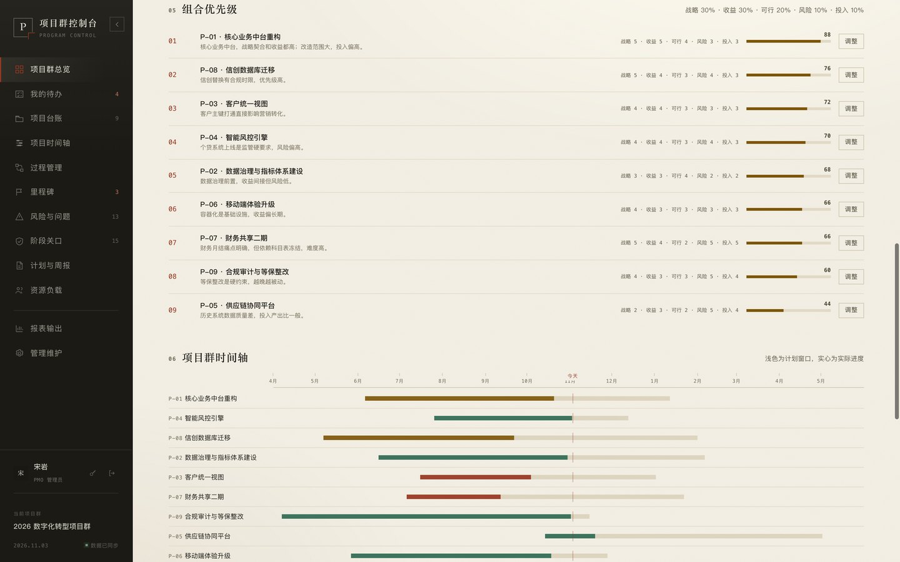

### 指标周快照与趋势

- 每周记录一次项目群指标：加权进度、平均健康、风险敞口、预算执行、收益达成、未关闭行动。
- 总览「指标趋势」显示最近 12 周，四张卡看本周值和环比，下面一张表看逐周明细。
- PMO 可以手动“记录本周快照”；服务启动时如果本周还没有，会自动补一条。
- 演示库预置 6 周历史快照，方便看趋势；主库从本周开始积累，不复制造假历史。

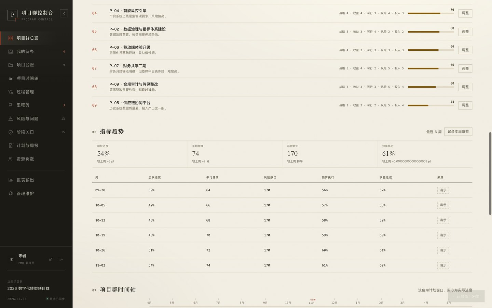

### 资源需求 vs 产能

资源页新增未来 6 个月的需求表：

- 按计划任务的开始/结束日期，把每个人每月被任务占用的工作日折算成 FTE。
- 一个人整月投入一个任务算 100%；多个任务重叠会累加。
- 每人每月产能按 100% 算，超过 100% 标红，80–100% 标黄。
- 成员和乙方供应商并排显示，峰值月份单独列出来。

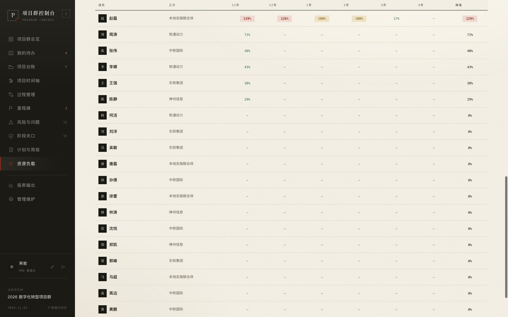

### 计划与周报

- **项目周报**：按 ISO 周维护，包含进度、本周进展、关键成果、下周计划、风险问题、需协调事项。
- **项目计划**：按季度或月度维护，包含目标范围、关键结果、资源需求、风险应对、需协调事项。
- **独立写作页**：不是把表单塞进弹窗。左侧写正文，右侧随时看到提交检查、项目现状、审核意见和历史版本。
- **自动保存**：停止输入 1.5 秒自动存草稿，状态栏显示保存时间；离开页面前会再存一次。
- **带入项目现状**：周报可一键带入台账进度、下阶段里程碑和未关闭风险；计划可一键复制上期内容，不会覆盖已填字段。
- **状态机**：`草稿 → 待审核 → 已通过 / 已退回`。已提交内容锁定，退回后可修改重提。
- **版本记录**：每次提交生成一版快照，退回重提会保留历史，PMO 审核时能看到改了哪几版。
- **沟通记录**：PMO 的审核意见和项目经理的回复留在同一条记录里，不再散落在聊天工具。
- **截止时间**：周报截止到周日 23:59，计划截止到周期开始后 14 天；逾期未交会在列表和统计里标出。
- **审核时效**：提交超过 48 小时未处理，会在列表、总览和审核弹窗里标记「审核超时」。
- PMO 审核时可以写意见；退回**必须**写原因。通过周报时，填报的项目进度会同步更新到项目台账。
- 未提交的草稿只有项目负责人和 PMO 可见，其他项目经理看不到内容。

### 报表输出

- **项目群周报**：总体情况、项目进展摘要（取自已提交的项目周报）、进度与里程碑、逾期节点、主要风险、需协调事项。显示本周提交与审核覆盖率。
- **项目群计划**：按季度汇总，包含总体目标、项目目标与关键结果、里程碑日历、资源需求、主要风险、需项目群决策事项。**只采纳已审核通过的项目计划**。
- 两者都可复制 Markdown、下载 `.md`、直接打印（打印样式已做优化）。

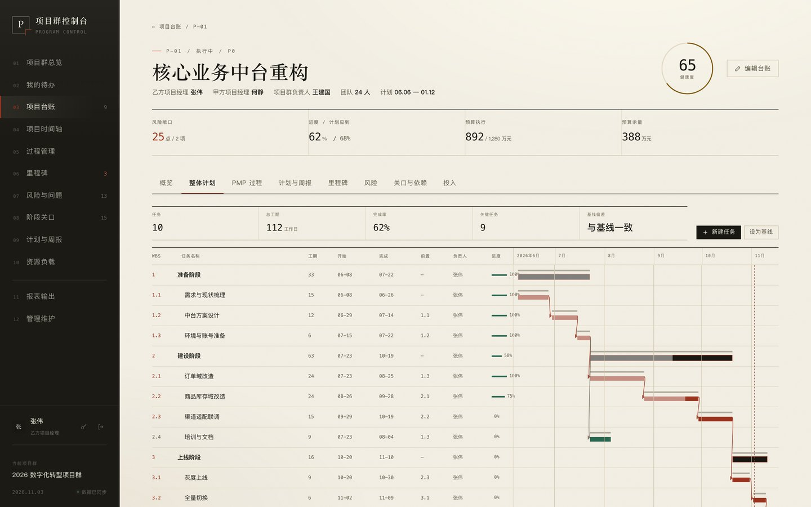

### 双项目经理

每个项目配两位项目经理：

- **乙方项目经理**：负责周报、计划、里程碑、风险、投入、章程、变更和经验教训的日常维护，可以提交审核。
- **甲方项目经理**：以查看为主，能进项目工作台、看周报和计划、在填报页留言，但不能改内容、不能提交、不能审批。
- **PMO**：指定哪位是甲方、哪位是乙方，负责审核和治理动作。

权限按项目台账里的 `vendor_pm_id` / `client_pm_id` 判断，不靠前端隐藏按钮。乙方换人后，旧项目经理立即失去维护权限。老库升级后如果某个项目还显示「未指定」，到项目台账点「编辑台账」补上两位经理即可；演示库已经全部配对。

甲方登录后的「我的待办」不是催他填报，而是列出乙方已提交的周报和计划，标「待审核 / 已通过」，点进去只读查看。


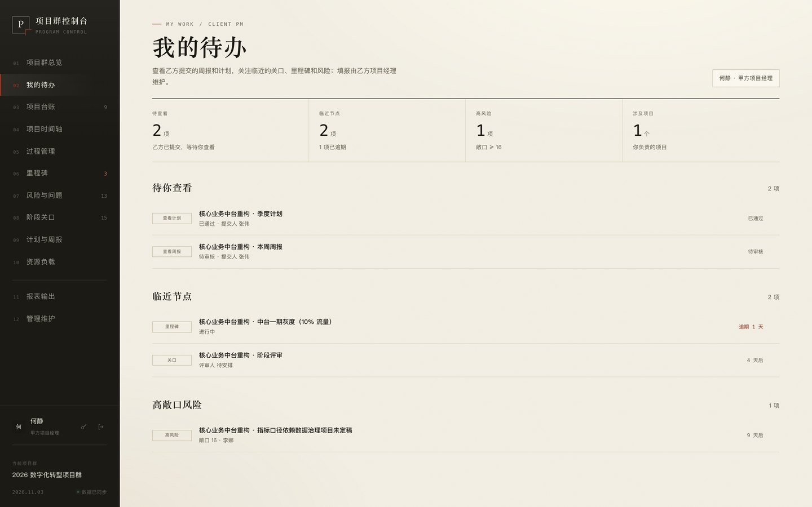

### 乙方供应商

供应商是独立主数据，不是成员姓名后面的一个备注。

- 管理维护新增「乙方供应商」页签：编码、名称、联系人、电话、合作状态、备注。
- 账号可以挂到供应商；乙方账号在用户编辑里选，甲方和 PMO 自动忽略。
- 项目「投入」页签添加成员时，可以选择该成员属于哪家乙方供应商。
- 团队列表直接显示“角色 · 供应商”；管理维护的账号列表也会显示供应商。
- 已被账号或项目成员引用的供应商不能删除，只能改成“暂停合作/已退出”，历史关联不丢。

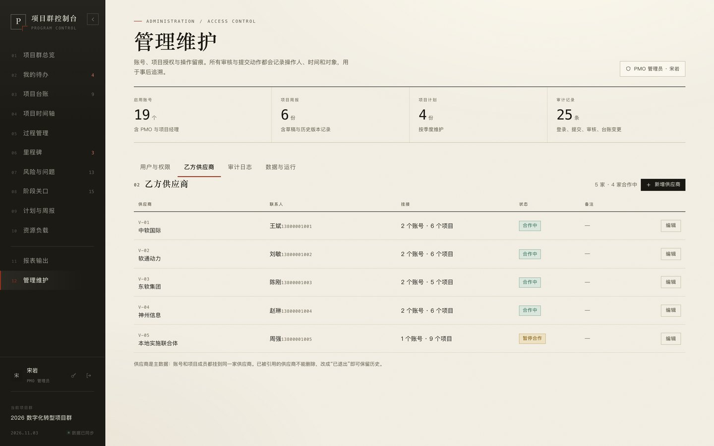

### 项目工作台

项目台账支持按阶段筛选和搜索。点进任一项目，是一个以项目为主线的管理工作台，不再只有一张静态详情页：

- **概览**：本周周报、本季度计划、下一个关口、高敞口风险四张行动卡；近期管理记录、未来 30 天节点、健康度构成和项目目标。
- **计划与周报**：最近 8 周的周报和最近 4 个季度的计划，逐周列出状态、进度、提交人、审核人、版本数和沟通数；缺的周期可以直接「补报」。
- **里程碑 / 风险**：本项目自己的清单，可直接新增或标记完成。
- **关口与依赖**：本项目的阶段关口结论、涉及本项目的上下游依赖。
- **投入**：人员投入和项目节奏。

这样 PMO 不用在“按周期”的列表里来回找某个项目交过什么，打开项目就能看到它的完整管理轨迹。

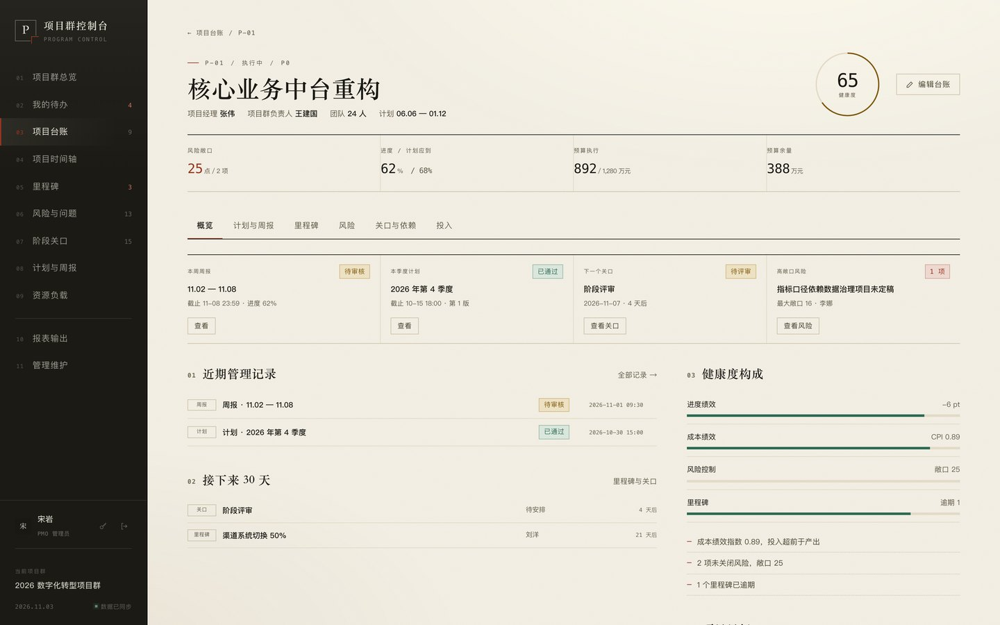

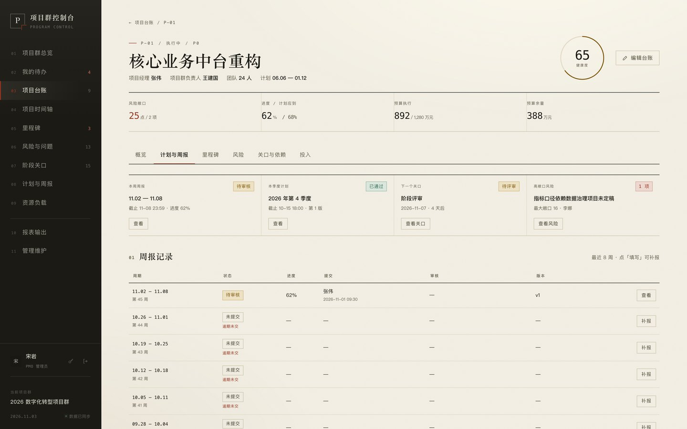

### 项目整体计划（WBS / 甘特）

参照 Microsoft Project 的任务表 + 甘特图模式，每个项目有自己的一份任务级计划，不再只有几个里程碑。

- **WBS 层级**：阶段 → 任务 → 子任务，支持缩进 / 升级；阶段日期和进度由子任务自动汇总。
- **工作日排期**：工期按工作日算，周末自动跳过；有前置任务时开始日期由系统排。
- **前置关系**：完成-开始（FS），可以选多个前置任务；循环依赖会被拒绝。
- **里程碑**：工期为 0，在甘特图上用菱形表示。
- **基线**：点「设为基线」保存当前开始/完成日期，之后改计划会保留灰色基线对照，并显示偏差。
- **关键路径**：没有浮动时间的任务标红，甘特图和依赖箭头同步标红。
- **进度与负责人**：每个任务可以填负责人和完成百分比，阶段自动汇总。
- **权限**：乙方项目经理和 PMO 可以维护；甲方项目经理只读。

和 Microsoft Project 的对应关系：

| Microsoft Project | 这里的实现 |
| --- | --- |
| 任务表 / WBS | WBS 编号、缩进层级、阶段汇总 |
| 工期 / 开始 / 完成 | 工作日自动排期 |
| 前置任务 | 完成-开始依赖，可多选 |
| 摘要任务 | 阶段节点，日期和进度自动汇总 |
| 里程碑 | 0 工期菱形 |
| 基线 | 设为基线，灰色对照条 |
| 关键路径 | 红色任务条和依赖箭头 |
| 资源 / 成本 | 只到负责人，不含任务级成本 |
| 日历 | 周一至周五，不含法定节假日 |


### 计划导入导出（Excel / CSV）

项目整体计划支持 CSV 导入导出，CSV 可以直接用 Excel 打开：

- 导出包含 WBS、父任务、任务名、类型、工期、计划起止、进度、负责人、乙方供应商、实际起止、前置任务、备注。
- 导入支持两种方式：追加到现有计划，或整体替换现有任务。
- 替换会清空原计划基线和任务依赖，导入后需要重新设基线；追加保留原基线。
- 导入时按 `vendor_code` 找供应商，按 `predecessors` 的 WBS 重建完成-开始依赖。
- 只有 PMO 和乙方项目经理能导入，甲方只能导出查看。
- 同时支持 Microsoft Project XML（MSPDI 常用子集）导出和导入：任务名、层级、工期、开始、完成比例、前置关系；“导入计划”会自动识别 `.csv` 和 `.xml`。
- MS Project 的 resource/calendar/cost 等高级字段不导出，导入也不覆盖这些设置。

### 工作日历与任务实际起止

- 管理维护新增「工作日历」：可以加法定假日（休息日）和调休上班（周末算工作日）。
- 排期会跳过休息日、把调休上班算成工作日；改日历后所有项目计划自动重算，并更新基线偏差。
- 计划任务可以填实际开始、实际完成，以及所属乙方供应商；任务行下方显示“供应商 · 实际日期”。
- 实际日期只用于跟踪，不反向改计划日期；计划日期仍由工期和前置任务排。

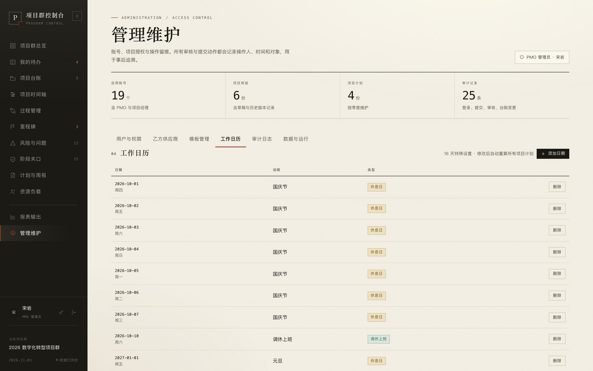

### 计划、周报、EVM 同源

这一版把“三套数”合成了一套：

- 有任务计划的项目，项目进度由任务按工期加权汇总，项目台账里的进度不能再手改。
- 周报打开时自动带出项目进度，并列出本周应完成/正在做的计划任务；当前周和未来周不能手改进度。
- 周报可以一键把本周任务带到“本周进展”，不用再照着甘特图重写一遍。
- EVM 的 PV 改为按任务基线计算“到今天应完成多少”，EV 用任务汇总出来的项目进度，不再拿项目起止日期估算。
- PMO 审核周报时，不再用周报里的百分比覆盖项目进度；进度只认任务计划。

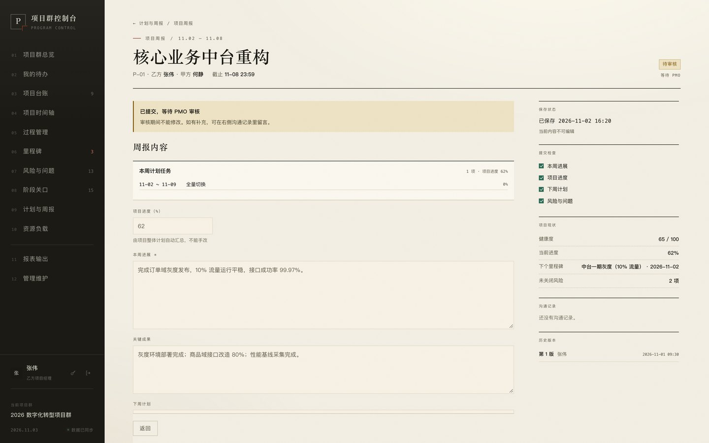

### 收益与行动

P1 补的是“项目做完得到什么”和“谁在什么时候把事做完”。

**收益台账**

- 每个项目登记收益指标：基线值、目标值、当前值、单位、方向（越高越好 / 越低越好）、责任人、要求实现时间。
- 自动算达成率，例如接口 P99 从 320ms 降到 230ms、目标 200ms，达成 75%。
- 逾期未达成标红；平均达成率在页头汇总。
- 目前当前值是手工维护，后续可以接财务或业务系统自动取数。

**行动项**

- 来源分关口、变更、风险、会议、其他。
- 有关键优先级、责任人、截止日、状态；逾期标红。
- 可以一键完成，也可以编辑或删除。
- 关口条件、变更遗留、风险应对都可以落到这里，不再只留在会议纪要里。

**甲方验收**

- 交付物（周报/计划）经 PMO 审核通过后，甲方项目经理可以登记正式验收结论：通过、有条件通过、不通过，记录确认人、时间和说明。
- 项目级、阶段级验收也可以登记，和普通评论分开。
- 同一条交付物只能有一条验收记录，避免重复确认。

**变更后基线**

- PMO 审批变更时，可以勾选“批准后更新计划基线”。
- 选“是”会按当前任务计划重设基线，并在审计日志里记一笔；选“否”保留原基线，便于看偏差。
- 没有任务计划的项目不能选更新基线，服务端会拒绝。

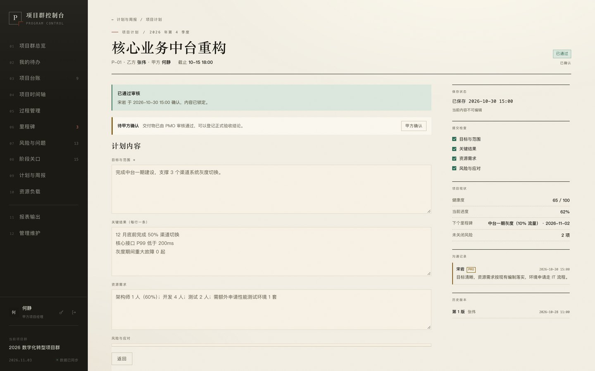

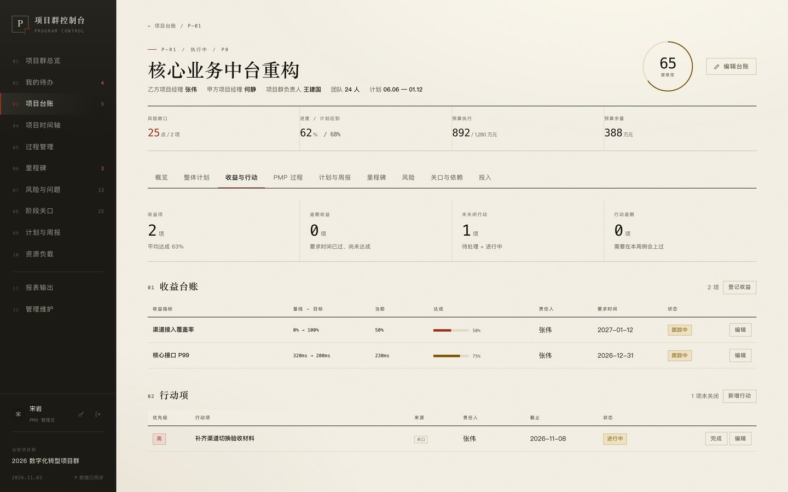

### PMP 过程管理

按 PMP 的五个过程组把项目管理动作串起来，而不是只堆功能：

| 过程组 | 系统里对应什么 |
| --- | --- |
| 启动 | 项目章程（目的、目标、范围、成功标准、假设、约束、关键干系人），提交 PMO 审批；立项评审关口 |
| 规划 | 季度计划、里程碑、风险登记册、预算与人员投入 |
| 执行 | 周报提交、团队投入维护、进度同步 |
| 监控 | 进度与健康度、高敞口风险应对、变更请求与审批、EVM（PV/EV/AC、SPI/CPI、EAC/VAC） |
| 收尾 | 验收评审、经验教训、项目结项 |

- **项目里多了一个「PMP 过程」页签**：五个过程组各一列，逐项显示已完成/未完成和证据；顶部直接列出还缺哪几项。
- **项目章程**：草稿 → 提交 → PMO 通过/退回，状态和审批意见留痕。
- **变更控制**：项目经理登记变更，写清范围/进度/成本影响；PMO 批准、拒绝或标记已实施。变更不会自动改预算和计划，避免“审批即改数”。
- **经验教训**：按知识领域记录背景、发生了什么、下次怎么做，结项前至少一条。
- **过程管理页**：项目群 9 个项目 × 5 个过程组的矩阵，按完整度排序，点进去就是该项目的缺口清单。

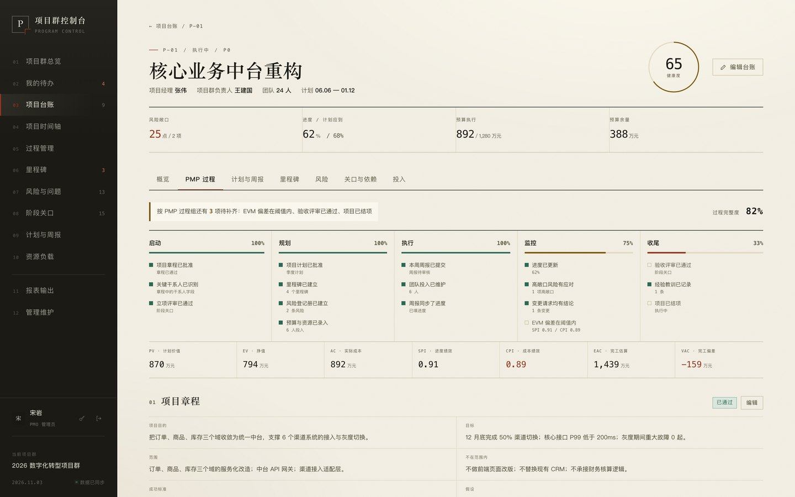

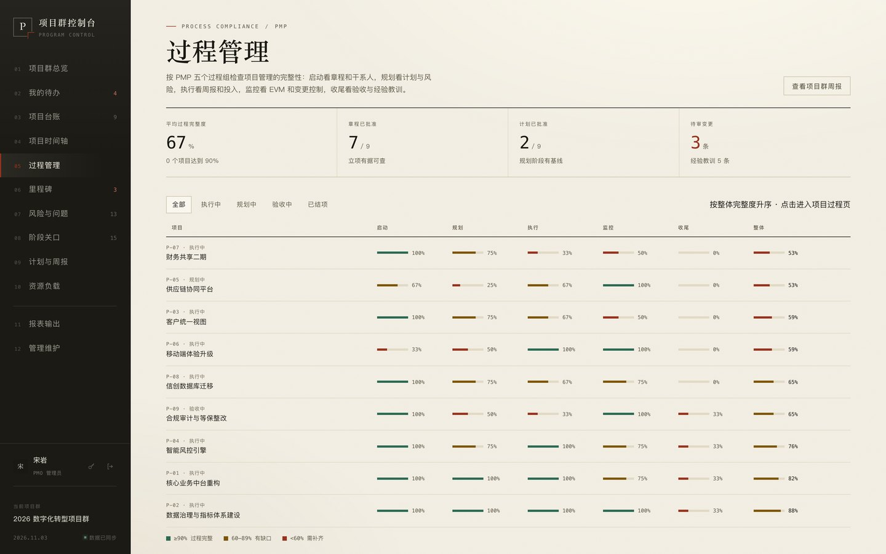

### 阶段关口

- 每个项目按「立项 / 阶段 / 验收」设置评审关口，记录计划日期、评审结论、评审人和必须补齐的条件。
- PMO 才能写结论；项目经理可查看本项目的关口。未填结论不允许标记通过。
- 未通过和有条件通过会保留条件，作为下次评审的输入；逾期未评审的关口标红。
- 总览的「两周内到期」把里程碑和关口合并排序。

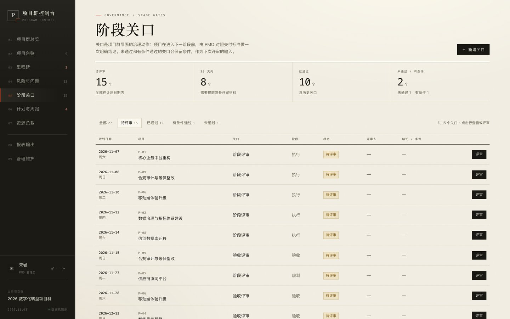

### 关口检查清单

关口不能只看一句结论。每个关口会按类型带一组标准检查项：

- 立项关口：立项材料完整、预算与资源已确认、关键干系人已确认。
- 阶段关口：阶段交付物齐备、关键风险有应对、下阶段计划已确认。
- 验收关口：验收标准逐项核对、遗留问题有处理计划、甲方确认意见已记录。

PMO 在「阶段关口」列表点“清单”，逐项打“未完成 / 已完成 / 不适用”。必检项没完成时，服务端会拒绝把结论改成“已通过”或“有条件通过”。

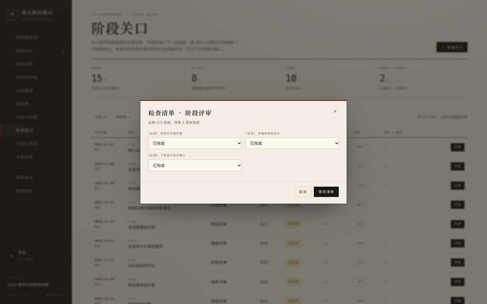

### 项目时间轴（甘特图）

- 周 / 月 / 季三档缩放，按项目阶段筛选，可只看自己负责的项目。
- 计划窗口、实际进度、里程碑菱形、今天竖线、周末底色、月份网格都在一张图上。
- 跨项目依赖用曲线连接，受阻的依赖画成红线；图上关闭依赖后可以只看排期。
- 左侧项目栏固定，右侧横向滚动；打开页面自动定位到今天。
- 下方列出全部跨项目依赖，PMO 可以新增、修改、删除。

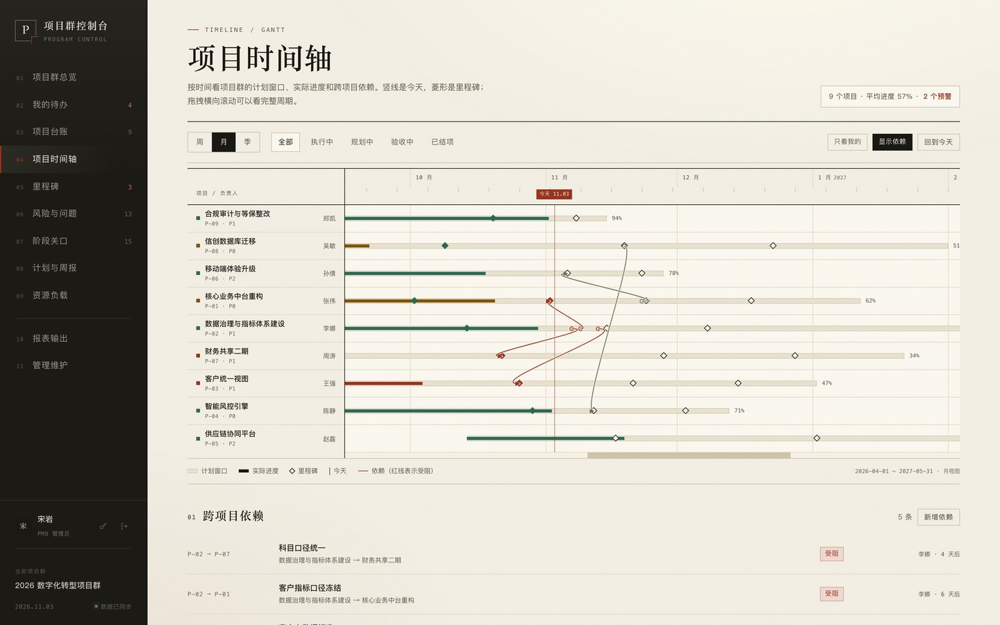

### 我的待办

参考 Asana My Tasks 的做法，把「今天该处理什么」收在一页：

- 项目经理：待提交的周报 / 计划、临近的关口和里程碑、高敞口风险。
- PMO：待审核的周报 / 计划、临近关口、里程碑、需要盯的风险。
- 按截止时间排序，逾期标红；审核任务显示已等待多少小时。

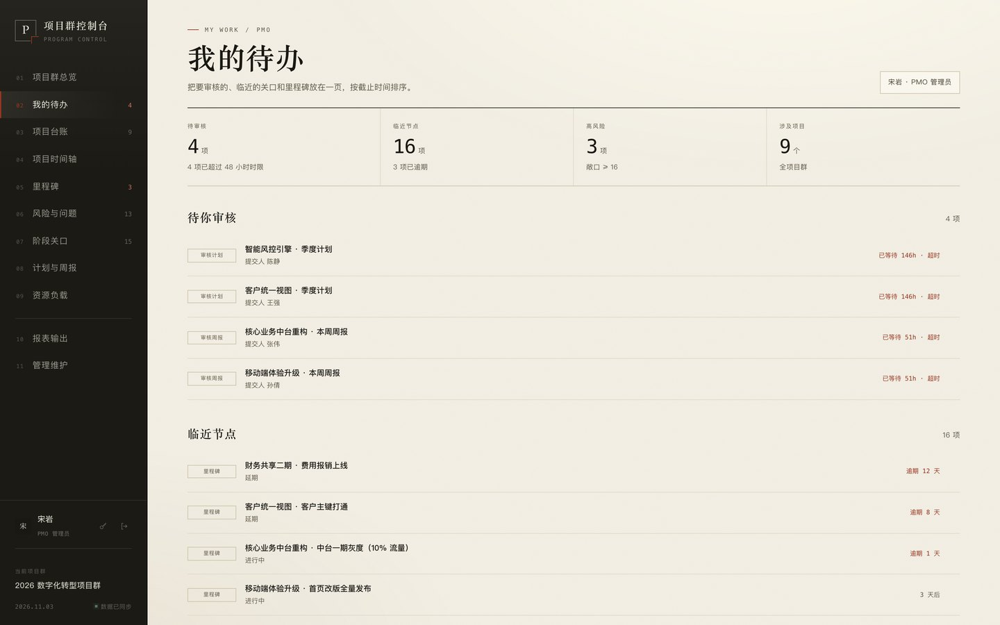

### 里程碑 / 风险 / 资源

- 里程碑：按月分组，逾期标红，一键完成，按时间窗筛选。
- 风险：RAID 四类条目，5×5 敞口矩阵可点击筛选，≥16 分自动进入周报的「需协调事项」。
- 资源：跨项目 FTE 汇总，标出过载与低负载。

### 安全基线与可访问性检查

CI 里除了接口、页面和压测，还跑一个安全基线脚本：

- 检查 CSP、X-Frame-Options、nosniff、Referrer-Policy、Permissions-Policy、COOP。
- 未登录访问接口返回 401；跨站 Origin 写请求返回 403。
- 检查登录 Cookie 的 HttpOnly / SameSite / Secure（HTTPS 代理下）和 HSTS。
- 检查路径穿越不泄露源码、SQL 注入式登录被拒绝、跨项目越权读取被拒绝、连续错误密码触发限流。
- 页面冒烟内置可访问性检查：按钮/链接/表单控件有可访问名称，图片有 alt，id 不重复，主地标和 h1 存在。

这不是第三方渗透测试，但能挡住常见的低级问题。安全基线脚本是 `npm run test:security`。

### CI、浏览器冒烟与压测

`package.json` 增加了两个不依赖第三方库的测试入口：

- `npm test`：38 项接口集成测试。
- `npm run test:ui`：启动临时服务和 Chrome，登录后检查侧栏收起、计划页、总览组合优先级、项目收益页；没有 Chrome 时可用 `SKIP_UI=1` 跳过，或通过 `CHROME_BIN` 指定路径。
- `npm run test:security`：CSP、Cookie、Origin、路径穿越、SQL 注入、越权、登录限流。
- `npm run test:load`：84 个请求、并发 7，跑 bootstrap、项目、计划、工作台、资源、关口、周报接口，输出 avg/p50/p95，p95 超过 2 秒或出现错误即失败。

本机实测：浏览器冒烟通过，压测 **avg 6ms / p50 6ms / p95 9ms / 0 错误**。CI 配置在 `.github/workflows/ci.yml`，推代码后依次跑接口测试、浏览器冒烟、轻量压测。

这是关键页面的冒烟和轻量压测，不是完整 E2E，也没有做渗透测试。

### 管理维护

**账号维护**

- 按姓名、账号、项目搜索；按角色（PMO / 项目经理）、归属（甲方 / 乙方）、状态筛选。
- 列表直接显示负责项目、最近登录时间、在线会话数。
- 新建账号：选角色、甲方/乙方归属、初始密码、可见项目。
- 编辑账号：改名、改角色/归属、调整项目可见范围、启停用、重置密码。
- 重置密码：默认生成 12 位随机密码，提交前可复制；提交后该账号所有会话立即失效。
- 强制下线：只踢会话，不停用账号，适合电脑丢失或人员临时离岗。
- 删除账号：不能删自己，不能删最后一个 PMO，仍担任项目甲方/乙方经理的账号必须先换人。

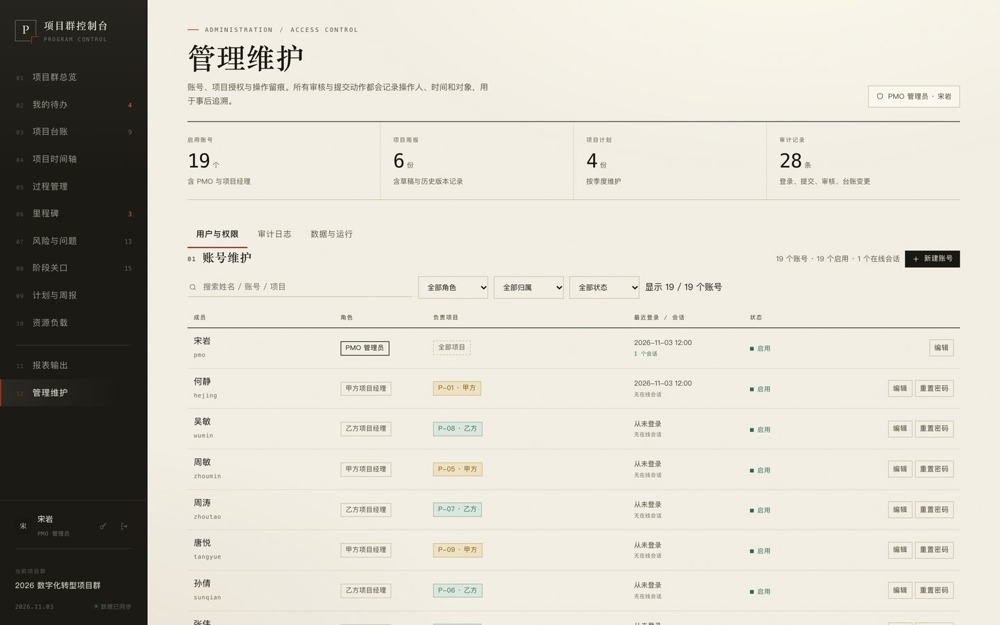

**审计与数据**

- **审计日志**：登录、提交、审核、退回、台账变更、账号维护全部留痕，按时间倒序展示。
- **数据与运行**：JSON 全量备份与恢复、重置演示数据、一键清空业务数据、健康度算法说明。
- **上线前清理**：清空业务数据会删除全部项目、周报、计划、关口、风险、依赖、章程、变更、经验教训和其他账号，只保留当前管理员；项目群重置为「默认项目群」，其他已登录会话立即失效。操作要输入「清空」确认，建议先导出 JSON 或做一次 `npm run backup`。
- 清空后总览不是一堆零，而是三步引导：新建项目 → 补里程碑和风险 → 提交第一份周报。

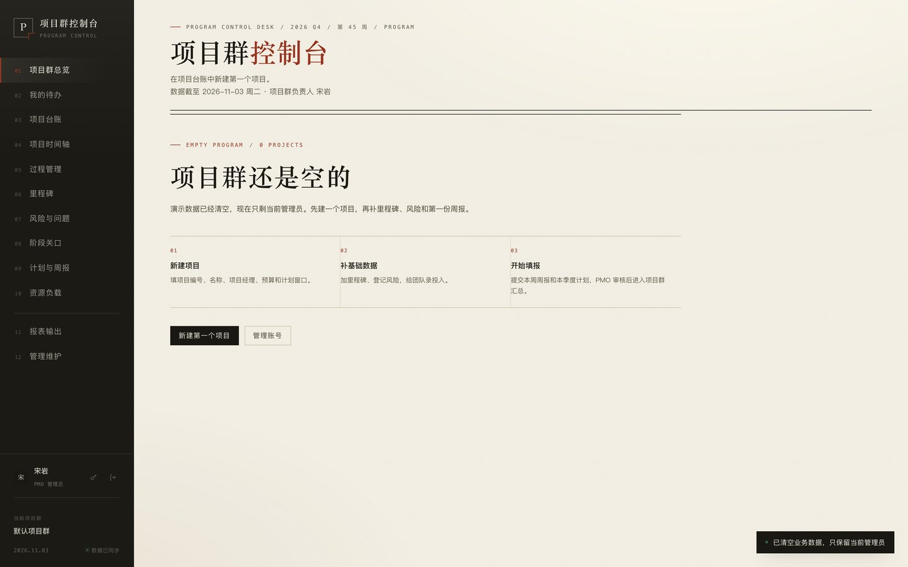

## 与 Asana 的对应关系

| Asana 能力 | 本项目现状 |
| --- | --- |
| Timeline（甘特 + 依赖） | 已实现，周/月/季缩放、依赖曲线、里程碑菱形 |
| My Tasks | 已实现，按角色汇总待提交、待审核、关口、里程碑、风险 |
| Portfolio | 项目群总览 + 组合健康表 |
| Workload | 资源负载页（跨项目 FTE） |
| Status updates | 项目周报（提交 + 审核 + 版本） |
| Goals / Benefits | 未做，见评估记录 P1 |
| Rules / Automation | 未做 |
| Forms | 未做 |

## 权限设计

| 操作 | PM | PMO |
| --- | --- | --- |
| 查看项目群与全部项目 | ✓ | ✓ |
| 维护自己项目的进度 / 里程碑 / 风险 / 投入 | ✓ | ✓ |
| 新建项目、修改其他项目台账 | — | ✓ |
| 填写并提交本项目周报 / 计划 | ✓ | ✓ |
| 审核、退回、撤回审核 | — | ✓ |
| 新增阶段关口、填写评审结论 | — | ✓ |
| 查看他人未提交的草稿 | — | ✓ |
| 管理账号与授权 | — | ✓ |
| 导入备份、重置数据 | — | ✓ |

甲方项目成员、乙方项目成员是项目级只读角色：在「用户与权限」里建账号并勾选项目，只能查看被分配项目的数据，不能修改、审批或管理账号。权限在服务端校验，前端隐藏按钮只是体验优化，不能绕过接口。

## 健康度算法

每个项目实时计算 0–100 分，不落库：

| 维度 | 权重 | 计算方式 |
| --- | --- | --- |
| 进度绩效 | 35% | 实际进度与「按计划应到进度」的偏差，每落后 1 个百分点扣 2.2 分 |
| 成本绩效 | 30% | CPI = 进度完成率 ÷ 预算消耗率，乘以 100 封顶 |
| 风险控制 | 25% | 100 − 未关闭风险敞口 × 4 |
| 里程碑 | 10% | 每个逾期节点扣 18 分 |

分级：**≥78 正常、58–77 关注、<58 预警**。详情页会列出扣分的具体原因，而不是只给一个分数。

## 技术说明

- **零依赖**：Node 22 内置 `node:sqlite` + `node:http`，前端原生 ES Module，无构建步骤、无 `node_modules`。
- **认证**：scrypt 加盐哈希密码；会话 Token 只存 SHA-256 摘要，HttpOnly + SameSite=Lax Cookie，7 天过期；写接口做同源校验；登录失败 5 次锁定 10 分钟；支持自助改密，改密后其他会话立即失效。
- **双项目经理**：项目经理账号带甲方 / 乙方归属；项目记录乙方、甲方两个 PM 和对应 ID；维护权限只给乙方 PM 和 PMO，甲方 PM 只读并可留言。
- **安全响应头**：CSP、X-Frame-Options、nosniff、Referrer-Policy、Permissions-Policy、COOP；反代 HTTPS 时自动给会话 Cookie 加 `Secure`、给响应加 HSTS。
- **代理识别**：读 `X-Forwarded-Proto: https`，Nginx 示例已经带上；直接 TLS 部署可设 `PMO_SECURE_COOKIE=1`。
- **审计**：关键动作写入 `audit_log`，与业务数据分开存储。
- **测试**：`node:test` 覆盖认证、权限、双项目经理、多项目群、帮助检索、知识库、项目知识库自动索引与笔记、项目 AI 知识库引用、全局 AI 跨项目范围与权限、管理员 AI 配置、账号维护、供应商主数据、模板管理、Markdown 周报与自动字段提取、工作日历、任务实际起止、计划 CSV/XML 导入导出、组合评分、指标快照、资源产能、项目整体计划、计划进度同源、周报带入、EVM 基线、收益与行动项、甲方验收、变更基线、关口清单、填报审核、版本与评论、PMP 章程/变更/经验教训、过程矩阵、关口、跨项目依赖、报表、备份恢复、清空演示数据等 49 项，使用 `PMO_DB` 指向临时库。
- **结构版本**：SQLite `user_version` 标记，后续加字段可按版本增量迁移。
- **填报数据**：`plans` / `weekly_reports` 存当前内容，`deliverable_revisions` 存提交快照，`deliverable_comments` 存沟通记录。
- 前端 hash 路由，所有数据库文本渲染前统一转义。
- 响应式：桌面为台账式宽表，窄屏切换为带标签的卡片布局。

```
.
├── server.js           # HTTP 服务、SQLite、权限、审核流程、报表生成
├── public/
│   ├── index.html
│   ├── app.css         # 视觉系统
│   └── app.js          # 登录、路由、各视图与交互
├── data/pmo.db         # 运行后生成
├── docs/               # 预览图
└── start.sh
```

主要接口：

| 方法 | 路径 | 说明 |
| --- | --- | --- |
| POST | `/api/auth/login` · `/api/auth/logout` | 登录 / 退出 |
| GET | `/api/me` | 当前用户、角色与待办统计 |
| GET | `/api/bootstrap` | 总览数据（含健康度与填报统计） |
| GET | `/api/deliverables?kind=weekly&period=…` | 某周期的周报/计划清单与统计 |
| POST/PATCH | `/api/deliverables/…` | 新建 / 修改草稿 |
| POST | `/api/deliverables/:kind/:id/submit` | 提交审核 |
| POST | `/api/deliverables/:kind/:id/review` | 通过 / 退回（PMO） |
| POST | `/api/deliverables/:kind/:id/reopen` | 撤回审核（PMO） |
| GET | `/api/projects/:id/workspace` | 项目工作台（历史周报/计划、章程、变更、经验教训、过程评分） |
| GET | `/api/projects/:id/plan` | 项目整体计划（WBS、排期、基线、关键路径） |
| POST/PATCH/DELETE | `/api/projects/:id/plan/tasks` · `/api/plan/tasks/:id` | 任务增删改 |
| POST | `/api/plan/tasks/:id/indent` · `/outdent` | 缩进 / 升级 |
| POST | `/api/projects/:id/plan/baseline` | 设置计划基线 |
| GET/POST/PATCH/DELETE | `/api/projects/:id/benefits` · `/api/benefits/:id` | 收益台账 |
| GET/POST/PATCH/DELETE | `/api/projects/:id/actions` · `/api/actions/:id` | 行动项 |
| GET/POST | `/api/projects/:id/acceptances` | 甲方验收记录 |
| GET/POST/PATCH/DELETE | `/api/vendors` · `/api/vendors/:id` | 乙方供应商主数据 |
| GET/POST/PATCH/DELETE | `/api/programs` · `/api/programs/:id` | 项目群维护 |
| GET | `/api/help` · `/api/ai/config` | 帮助检索、AI 配置状态 |
| GET/PUT | `/api/admin/ai` | 管理员读取/保存 AI 配置（Key 不回显） |
| POST | `/api/admin/ai/test` | 测试 AI 连接 |
| POST | `/api/help/ask` | 知识库智能问答 |
| POST | `/api/projects/:id/ai` | 项目 AI 摘要/周报/风险/提问（含知识库引用） |
| POST | `/api/ai/assistant` | 全局 AI：项目群摘要、跨项目风险、自由提问 |
| GET/POST/PATCH/DELETE | `/api/projects/:id/kb` · `/api/projects/:id/kb/notes/:noteId` | 项目知识库检索与手工笔记 |
| GET/POST/PATCH/DELETE | `/api/admin/help` · `/api/admin/help/:id` | 知识库文章维护 |
| GET/POST/PATCH/DELETE | `/api/templates` · `/api/templates/:id` | 项目管理模板 |
| GET/POST/DELETE | `/api/calendar` · `/api/calendar/:date` | 工作日历 |
| PATCH | `/api/projects/:id/score` | 更新组合优先级评分（PMO） |
| GET | `/api/snapshots` | 指标周快照 |
| GET | `/api/resources` | 资源负载与未来 6 个月产能对比 |
| GET/POST/PATCH/DELETE | `/api/meeting-rooms` · `/api/meeting-rooms/:id` | 会议室维护 |
| GET/POST | `/api/meeting-bookings` | 会议室预订查询与创建 |
| POST | `/api/meeting-bookings/:id/approve` · `/reject` · `/cancel` | 预订审批与取消 |
| GET/POST/PATCH/DELETE | `/api/supplies` · `/api/supply-items` · `/api/supply-categories` | 办公用品目录与维护 |
| GET/POST | `/api/supply-requests` | 领用申请、我的领用、待发放 |
| POST | `/api/supply-requests/:id/issue` · `/reject` · `/cancel` | 发放、拒绝、取消 |
| GET | `/api/projects/:id/plan/export.csv` | 导出计划 CSV（Excel 兼容） |
| POST | `/api/projects/:id/plan/import` | 导入计划 CSV（追加/替换） |
| GET | `/api/projects/:id/plan/export.xml` | 导出 MS Project XML（MSPDI 子集） |
| POST | `/api/projects/:id/plan/import.xml` | 导入 MS Project XML |
| POST | `/api/admin/snapshot` | 记录本周快照（PMO） |
| GET | `/api/gates/:id/checks` | 关口检查清单 |
| POST | `/api/gates/:id/checks/default` | 生成默认检查清单 |
| PATCH | `/api/gates/checks/:id` | 更新检查项状态 |
| GET | `/api/admin/audit.csv` | 导出审计日志 CSV（PMO） |
| GET | `/api/process-matrix` | 项目群 PMP 过程矩阵 |
| POST | `/api/projects/:id/charter` · `/charter/submit` | 保存章程草稿 / 提交审批 |
| POST | `/api/projects/:id/charter/review` | 章程通过或退回（PMO） |
| POST | `/api/projects/:id/changes` | 登记变更请求 |
| PATCH | `/api/changes/:id` | 变更审批（PMO） |
| POST | `/api/projects/:id/lessons` | 记录经验教训 |
| GET | `/api/deliverables/:kind/by-project/:projectId` | 写作页数据（含版本、评论、截止时间） |
| POST | `/api/deliverables/:kind/:id/comments` | 项目经理 / PMO 留言 |
| GET/POST/PATCH | `/api/gates` | 阶段关口查询 / 新增 / 评审（PMO） |
| GET/POST/PATCH/DELETE | `/api/dependencies` | 跨项目依赖维护（PMO） |
| POST | `/api/auth/password` | 自助修改密码 |
| GET | `/api/report` · `/api/report.md` | 项目群周报 |
| GET | `/api/program-plan` · `/api/program-plan.md` | 项目群计划 |
| GET/POST/PATCH/DELETE | `/api/admin/users` | 账号维护、启停用、项目授权、删除（PMO） |
| POST | `/api/admin/users/:id/reset-password` | 重置密码并踢掉旧会话（PMO） |
| POST | `/api/admin/users/:id/logout` | 强制下线（PMO） |
| GET | `/api/admin/audit` | 审计日志（PMO） |
| GET/POST | `/api/export` · `/api/import` | 备份与恢复 |

## 边界与注意

- 认证是本地账号体系，没有对接 SSO / LDAP / 企业微信；要接入需要另写一个身份适配层。
- 没有收益跟踪、WBS、会议决策/行动项。变更控制、经验教训和 EVM 已经覆盖，收益与 WBS 是下一步重点，详见 [评估记录](docs/assessment.md)。
- 没有邮件或 IM 催办。当前靠总览上的「本周填报」状态条和导航角标提示待办。
- 周报/计划是纯文本字段，不支持附件上传。需要附材料时建议在项目文档库里存，把链接写进「需协调事项」。
- 项目整体计划只支持完成-开始依赖和周一至周五日历；没有任务级成本、资源平衡、节假日日历和拖拽改期。
- 跨项目时间轴是只读的，不能像 Asana 那样拖拽改期；改计划日期要到项目台账、整体计划或计划填报里改。
- 没有 Asana 的 Rules / Forms / Goals；收益目标和自动化规则仍在待办清单里。
- 演示数据按当天日期相对生成，任何时候打开都像「正在进行中」；可在「管理维护 → 数据与运行」重置，或用「清空业务数据」进入正式使用状态。
- 默认只监听 `127.0.0.1`。多人使用请在前面加反向代理、HTTPS 和统一认证。


## 评估记录

对照 P3O/MoP、PMI Program Management、OWASP ASVS 5.0 与 WCAG 2.2 的评分、这轮改动与未做事项，见 [docs/assessment.md](docs/assessment.md)。
